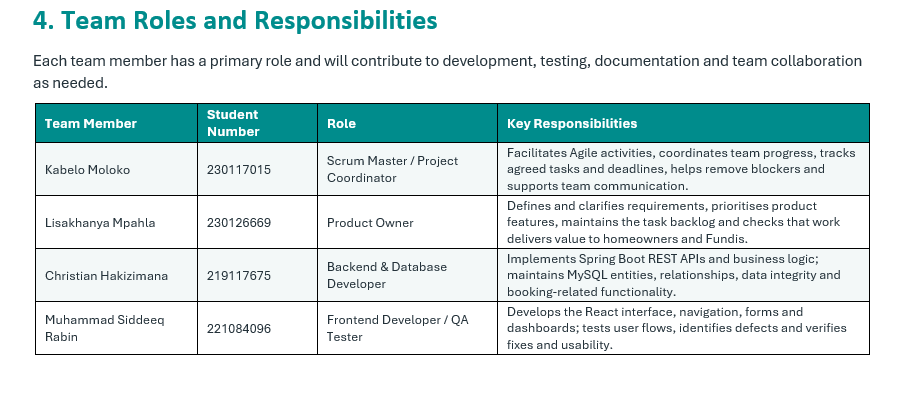

# Agile Team Charter

*The shared purpose, values, working agreements and boundaries that guided our team's collaboration during the development of FundiShop.*

[Home & CV](README.md) | [Agile Project Portfolio (FundiShop)](portfolio.md) | **Agile Team Charter** | [User Stories and Tasks](user-stories.md) | [Product Backlog](product-backlog.md) | [Sprint Backlog](sprint-backlog.md) | [Agile Logbook](logbook.md) | [Full FundiShop Document](FundiShop_PRP370_Portfolio.md)

---

## 1. Introduction

The Agile Team Charter established the foundation for how our team would work together during the development of FundiShop. It defined our project's purpose, team responsibilities, shared values, communication practices and working agreements. The charter helped us understand what we wanted to achieve, how responsibilities would be distributed and what was expected from each team member. It also provided a common reference for handling challenges, making decisions and maintaining accountability throughout the project. By establishing these expectations at the beginning, our team had a clearer direction for developing FundiShop as a service marketplace that connects homeowners with trusted local professionals, known as Fundis.

## 2. Evidence

The main evidence for this section is the FundiShop Agile Team Charter. The document records the project's purpose, team members, assigned responsibilities, communication practices, working agreements, Definition of Done, potential risks and team sign-off.

The charter demonstrates how our team organised itself before and during development. It provided a foundation for distributing responsibilities, coordinating development activities and establishing expectations for teamwork and project quality.

**Supporting document:** [View the complete FundiShop Agile Team Charter (PDF)](agile_Team_Charter.pdf)

*Figure 1: FundiShop Agile Team Charter, prepared in 2026. The document records the project purpose, team members, assigned roles, working agreements and sign-off section.*

## 3. Team Members and Responsibilities

Our FundiShop development team consisted of four members. Responsibilities were divided according to the roles assigned to each member to encourage accountability and ensure that different areas of the project received attention.

| Team member | Assigned role | Main responsibilities |
|---|---|---|
| Kabelo Moloko | Scrum Master and Project Coordinator | Coordinating team activities, supporting Agile practices, monitoring progress and helping the team remain focused on sprint goals. |
| Lisakhanya Mpahla | Product Owner | Representing product requirements, helping prioritise features and ensuring that development activities support the needs of the intended users. |
| Christian Hakizimana | Backend and Database Developer | Contributing to backend development, database design, application functionality, system integration and testing. |
| Muhammad Siddeeq Rabin | Frontend Developer and Quality Assurance | Contributing to frontend development, user-interface implementation, usability and quality checks. |

Dividing responsibilities helped each team member understand their expected contribution. However, the project also required collaboration because frontend functionality, backend services and database operations depended on one another.

## 4. Project Purpose and Shared Goals

The purpose of FundiShop was to develop a web-based service marketplace that connects homeowners with local service professionals, referred to as Fundis.

The platform was designed to make it easier for homeowners to find suitable service providers, view professional information and submit service booking requests. It also aimed to provide Fundis with a way to manage their profiles and respond to booking requests.

Our shared goals included:

- Developing a functional and user-friendly service marketplace.
- Providing separate experiences for homeowners and Fundis.
- Allowing users to register and log in to the platform.
- Enabling homeowners to find service providers and request bookings.
- Allowing Fundis to manage their professional profiles and booking requests.
- Designing and maintaining a database that supports the application's main features.
- Testing the system to identify errors and improve reliability.
- Maintaining communication and collaboration throughout development.

These goals gave the team a common understanding of the product and helped guide the requirements and tasks that were developed later.

## 5. Team Values and Working Agreements

Our team recognised that successful Agile development depends on more than completing individual programming tasks. It also requires communication, accountability, cooperation and respect.

The following working principles guided our collaboration:

**Communication:** Team members were expected to share progress, discuss technical problems and communicate when they needed assistance. Microsoft Teams meetings and Trello updates supported communication and progress tracking.

**Accountability:** Each member was responsible for making progress on their assigned tasks and informing the team when difficulties affected their work.

**Collaboration:** Team members were expected to assist one another where possible, particularly when frontend, backend and database components needed to work together.

**Respect:** Everyone's ideas and contributions were to be considered during discussions and decisions.

**Transparency:** Progress, unfinished tasks and challenges needed to be communicated honestly so that the team could respond appropriately.

**Continuous improvement:** The team needed to reflect on its working methods and identify improvements after experiencing difficulties.

## 6. Communication and Decision-Making

Communication was an important part of the FundiShop development process because team members worked on different parts of the same application.

Microsoft Teams was used for team discussions and meetings, while Trello supported task organisation and progress tracking. These tools helped the team communicate about assigned work, monitor activities and identify tasks that still required attention.

When making decisions, the team needed to consider the project's objectives, user requirements, available time and technical limitations. Decisions about features and priorities were expected to support the overall purpose of FundiShop.

Technical decisions also required cooperation. For example, frontend pages depended on backend API endpoints, while backend functionality depended on correctly structured database entities and relationships. This meant that changes in one area could affect another part of the application.

## 7. Definition of Done

The Definition of Done established the minimum expectations for considering a development task complete.

For FundiShop, a task was considered complete when:

- The task's requirements and expected outcome were understood.
- The required functionality had been implemented.
- The code was checked for obvious errors.
- The feature worked as expected during testing.
- Relevant frontend, backend and database components were integrated where necessary.
- Any identified problems were addressed or communicated to the team.
- The completed work was reflected in the team's project tracking records.

This agreement helped prevent the team from considering a task finished simply because coding had stopped. A feature needed to work correctly and contribute to the overall application.

## 8. Challenges, Risks and How We Responded

One challenge experienced during the project was inconsistent team meeting attendance and communication. Some meetings were cancelled because of communication difficulties and technical problems experienced by team members. This affected the team's ability to discuss progress, coordinate activities and address problems together.

To improve the situation, the team proposed using a poll to identify a suitable daily meeting time that would work for everyone. This approach was intended to make scheduling more inclusive and reduce confusion about meeting arrangements.

Another important challenge involved coordinating the different technical components of FundiShop. The frontend and backend needed to communicate correctly, and the application depended on the database being properly configured. For example, during development, the frontend registration functionality encountered a CORS issue when communicating with the Spring Boot backend. This demonstrated the importance of early integration testing and communication between development responsibilities.

The team also needed to consider the following project risks:

- **Communication risks:** Delayed responses and missed meetings could affect coordination.
- **Technical risks:** Integration problems could prevent different application components from working together.
- **Time-management risks:** Delays in completing assigned tasks could affect sprint progress.
- **Quality risks:** Insufficient testing could allow errors to remain in the application.
- **Requirement risks:** Unclear or changing requirements could result in unnecessary development work.

These challenges demonstrated why the team needed clear working agreements, regular progress updates and continuous testing.

## 9. Reflection

Our FundiShop team consisted of Kabelo Moloko, Lisakhanya Mpahla, Christian Hakizimana and Muhammad Siddeeq Rabin. We divided responsibilities according to our assigned roles to support collaboration and ensure that the main areas of the project were covered. Kabelo was assigned the role of Scrum Master and Project Coordinator, Lisakhanya was the Product Owner, I was responsible for backend and database development, and Muhammad was responsible for frontend development and quality assurance. Our team's purpose was to develop FundiShop, a web-based service marketplace that connects homeowners with local professionals, known as Fundis. The platform was intended to help homeowners find service providers and manage bookings while allowing Fundis to manage their profiles and booking requests.

The working agreements that mattered most were communication, task allocation, decision-making and the Definition of Done. Communication was important because the frontend and backend components needed to work together for the application to function correctly. Sharing progress and raising problems early helped the team understand what had been completed and what still needed attention. Clearly assigned responsibilities also helped each member understand their contribution to the project. The Definition of Done was especially important because writing code did not automatically mean that a feature was complete. A feature needed to satisfy its requirements, work as intended, be tested and integrate with the relevant parts of the system. Decisions about requirements and priorities also needed to support the project's overall objectives and the needs of homeowners and Fundis.

During the project, one difficulty we experienced was inconsistent communication around team meetings. Some meetings were cancelled because of poor communication and technical difficulties experienced by team members. This made it harder to maintain a consistent discussion of progress and coordinate the next development activities. To address this problem, the team proposed using a poll to agree on a suitable daily meeting time. This experience showed me that communication agreements must be practical and consistently followed. It also demonstrated that team members should communicate scheduling difficulties early instead of allowing misunderstandings to affect the team's progress.

Another important learning experience came from integrating the frontend with the backend. During registration development, the frontend encountered a CORS error when sending requests from the Vite development server to the Spring Boot backend. This demonstrated that completing individual components does not guarantee that the entire system will work correctly. The components must also be tested together. I learned that technical problems should be communicated clearly, investigated systematically and addressed through cooperation rather than treated as isolated tasks.

The charter provided a common reference for the team's responsibilities and agreed ways of working. It established expectations around collaboration, accountability, quality and communication. However, a charter is only useful when team members apply it throughout the project. Coordination was particularly important when frontend components, backend APIs and database functionality had to work together. When challenges occurred, the team needed to communicate clearly, identify the cause of the problem, clarify responsibilities and work towards a solution. Reflecting on these experiences helped me understand that creating a charter is only the first step; team members must continue to follow and review the agreements as the project progresses.

Through this project, I learned that successful teamwork requires more than dividing tasks among individuals. It requires accountability, mutual respect, clear communication and a willingness to help other members when challenges arise. I also learned that individual contributions must fit together to produce a working system. The Agile Team Charter helped establish shared expectations and provided a foundation for organising the team's work. It also connected to later project artefacts, including user stories, the product backlog, the sprint backlog and the Agile logbook. These artefacts helped translate the team's overall purpose into requirements, prioritised tasks, planned work and records of progress.

Overall, developing and applying the Agile Team Charter improved my understanding of teamwork, responsibility and Agile project management. It taught me the importance of having a shared direction, assigning responsibilities clearly, maintaining communication, checking the quality of completed work and improving the team's approach throughout the development process.

## 10. Connection to the Other Portfolio Sections

The Agile Team Charter is the starting point of the FundiShop portfolio because it explains the team's purpose, responsibilities and working agreements.

The next section, **User Stories and Tasks**, translates the project's purpose into requirements from the perspectives of homeowners and Fundis. These stories help explain what users need from the application and what functionality the team must develop.

The **Product Backlog** builds on those requirements by organising and prioritising the features, improvements and technical work required for FundiShop.

The **Sprint Backlog** then identifies the work selected for a particular sprint and provides a more focused plan for completing it.

Finally, the **Agile Logbook** records development activities, daily progress, challenges and reflections. It provides a record of how the team worked towards its goals and how the project developed over time.

Together, these sections demonstrate the journey from establishing the team's direction to identifying requirements, planning development work and reflecting on the progress made.

## 11. Conclusion

The FundiShop Agile Team Charter established the foundation for our team's collaboration and development activities. It helped define our shared purpose, clarify responsibilities and establish expectations for communication, accountability and software quality. Although challenges occurred during the project, these experiences demonstrated the importance of reviewing working agreements and improving the team's approach. The charter was therefore not just an initial planning document but a reference that supported the team's development journey. It provided the starting point for the other Agile portfolio artefacts and helped connect our teamwork practices with the development of the FundiShop application.

---

[← Home & CV](README.md) | [User Stories and Tasks →](user-stories.md)

*© 2026 Christian Hakizimana · 219117675 · CPUT Diploma in ICT · PRP370S/371S/372S*
