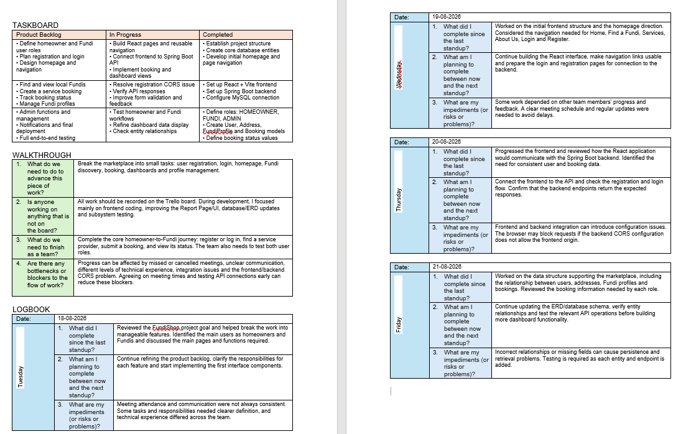
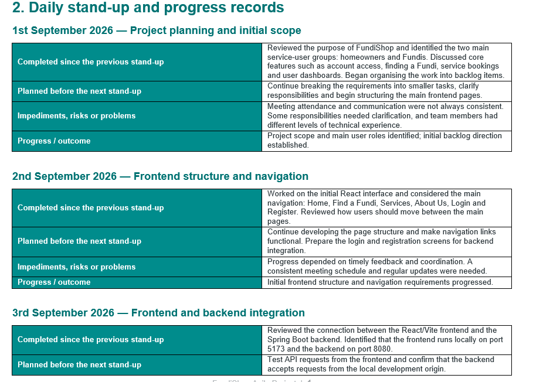
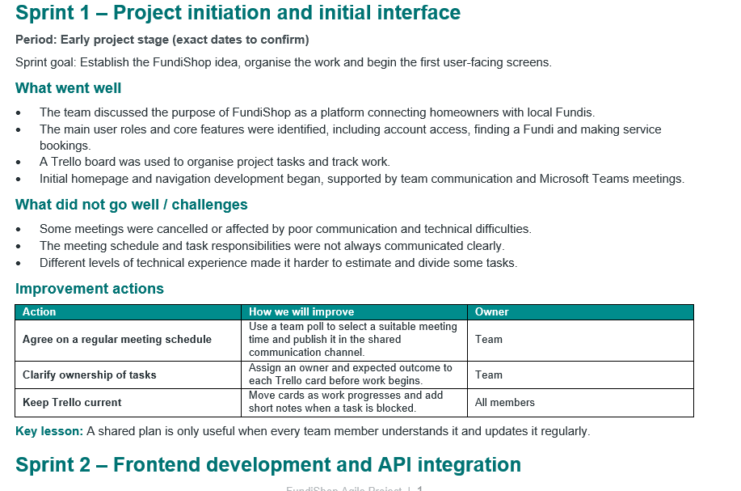

# Agile Logbook

*Daily stand-ups, sprint planning, progress updates and retrospective notes.*

[Home & CV](README.md) | [Agile Project Portfolio (FundiShop)](portfolio.md) | [Agile Team Charter](charter.md) | [User Stories and Tasks](user-stories.md) | [Product Backlog](product-backlog.md) | [Sprint Backlog](sprint-backlog.md) | **Agile Logbook**

## Introduction

The Agile Logbook documents the activities, progress, challenges and lessons learned throughout the development of FundiShop. It provides a record of how the team planned its work, communicated during development, monitored sprint activities and reflected on its performance.

FundiShop is a web-based service marketplace that connects homeowners with local service providers, known as Fundis. The application uses a React frontend, a Spring Boot backend and a MySQL database.

This logbook connects the team's daily development activities to the sprint goals and overall project objectives. It also demonstrates how Agile practices such as regular communication, task tracking, collaboration and retrospectives support the development of a software project.

## Evidence

The following evidence supports the activities recorded in this logbook. It includes the team's Agile planning, daily progress records and sprint retrospective documentation.

[View the Full Agile Logbook Document](logbook.pdf)

*Figure 1: FundiShop Agile logbook showing development activities, progress and team discussions, 2026.*

[View the Full Agile Team Daily Stand Up Document](daily.pdf)

*Figure 2: FundiShop daily stand-up and progress records.*

[View the Full Retrospective and Improvement Actions Document](retrospective.pdf)

*Figure 3: FundiShop sprint retrospective and improvement actions.*

## Sprint Planning Record

Sprint planning is an important Agile activity because it allows the team to agree on what should be achieved during a sprint. The team reviews the product backlog, selects suitable items and breaks them into smaller tasks.

For FundiShop, sprint planning should focus on delivering useful functionality that supports the main marketplace workflow. The selected tasks should be realistic for the sprint period and should consider the team's capacity, technical dependencies and priorities.

### Proposed Sprint Goal

Develop and improve the main FundiShop user workflow, including account access, Fundi discovery and the ability for homeowners to request and view bookings.

### Planning Activities

The following activities provide a structure for sprint planning:

- Review the prioritised product backlog.
- Discuss the requirements of selected user stories.
- Identify dependencies and technical requirements.
- Break larger user stories into smaller development tasks.
- Allocate responsibilities according to team roles and availability.
- Agree on the sprint goal and expected outcomes.
- Record selected tasks and assignments on Trello.

### Sprint Planning Outcome

The intended outcome of sprint planning is a sprint backlog that clearly identifies the work selected for the sprint, the tasks required to complete it and the responsibilities of team members.

The sprint backlog should also provide a reference for monitoring progress during daily discussions and reviewing the team's achievements at the end of the sprint.

*Confirm the sprint goal and selected work against the actual Trello sprint board before submission.*

## Daily Stand-up Records

Daily stand-ups provide an opportunity for team members to communicate their progress, explain what they plan to work on next and identify anything preventing them from completing their tasks.

These discussions help the team remain informed about development activities and identify problems before they affect the sprint goal.

The following table is a suggested record format. Replace the example entries with the team's actual meeting dates, discussions and outcomes.

| Meeting | Progress | Next steps | Blockers or issues |
|---|---|---|---|
| Day 1 | Review project requirements and identify sprint tasks. | Begin work on assigned development tasks. | Some requirements may need clarification. |
| Day 2 | Continue work on frontend and backend components. | Complete initial implementation and prepare for integration. | Dependencies between frontend and backend need attention. |
| Day 3 | Continue development of selected features. | Connect frontend components to backend endpoints. | Investigate API or database errors if encountered. |
| Day 4 | Review the current implementation and test functionality. | Resolve identified issues and continue testing. | Integration problems may require additional debugging. |
| Day 5 | Review progress against the sprint goal. | Complete outstanding work and prepare for sprint review. | Identify unfinished tasks for future planning. |

*These are illustrative entries, not verified records of five actual meetings.*

### Daily Stand-up Questions

During daily stand-ups, team members can use three main questions to structure their updates:

1. What work did I complete since the previous meeting?
2. What work will I focus on next?
3. Are there any blockers or challenges affecting my progress?

Using these questions helps keep discussions focused and gives the team an opportunity to offer support where necessary.

## Team Contributions

The team's agreed roles provide a structure for coordinating project activities and responsibilities.

| Team member | Role | Responsibilities |
|---|---|---|
| Kabelo Moloko | Scrum Master and Project Coordinator | Support Agile activities, coordinate communication and help identify blockers. |
| Lisakhanya Mpahla | Product Owner | Clarify requirements, represent user needs and prioritise product features. |
| Christian Hakizimana | Backend and Database Developer | Contribute to backend development, REST APIs, database design, database operations and integration. |
| Muhammad Siddeeq Rabin | Frontend Developer and Quality Assurance | Contribute to user interface development, frontend integration and testing. |

These responsibilities help the team coordinate its work while ensuring that different areas of the application receive attention.

Actual task ownership and completed contributions should be supported by Trello assignments, development records or other project evidence.

## Development Progress and Challenges

The development of FundiShop involves different components that must work together to deliver the complete application. The React frontend provides the user interface, the Spring Boot backend handles application logic and REST API requests, and the MySQL database stores the application's information.

Development therefore requires coordination between the different components to ensure that information is correctly exchanged and that features work as expected.

### Technical Development Areas

The project includes the following technical areas:

- Developing and improving React user interfaces.
- Implementing backend functionality using Spring Boot.
- Creating and maintaining REST API endpoints.
- Designing and updating the database structure and ERD.
- Connecting application features to the MySQL database.
- Implementing Fundi profiles and booking operations.
- Testing communication between the frontend and backend.
- Performing subsystem testing to identify errors.

### Technical Challenges

One technical challenge encountered during frontend and backend development was the need to configure communication between the two components correctly. For example, a CORS configuration problem can prevent a frontend application running on one local port from accessing a backend API running on another port.

This type of problem demonstrates the importance of checking API configuration, request methods and backend responses during integration.

Another important development consideration is ensuring that booking information is correctly associated with the homeowner and the selected Fundi. This requires appropriate database relationships and correct backend operations.

These challenges show why development should include regular testing rather than waiting until the entire application has been completed.

### Lessons from Development Challenges

The following practices can help address technical and coordination challenges:

- Test backend endpoints independently before connecting them to the frontend.
- Check API URLs and configuration when requests fail.
- Verify database relationships and stored information.
- Test individual subsystems before complete system integration.
- Communicate technical blockers as soon as they are identified.
- Record problems and solutions so that the team can learn from them.

## Sprint Review

A sprint review allows the team to evaluate the functionality developed during the sprint and compare the results with the original sprint goal.

The team should demonstrate completed functionality, discuss unfinished tasks and gather feedback that can guide future development.

| Review area | Details to record |
|---|---|
| Completed work | List the features and tasks completed and verified during the sprint. |
| Unfinished work | Identify tasks that remained incomplete and explain their status. |
| Testing results | Record the tests performed and any defects identified. |
| Feedback | Document feedback from the team and relevant stakeholders. |
| Next steps | Identify work that should return to the product backlog or be considered for the next sprint. |

### Sprint Review Questions

- Did the team achieve the sprint goal?
- Which selected features were successfully implemented?
- Which tasks were not completed?
- Were the completed features tested against their acceptance criteria?
- What feedback was received?
- What should be prioritised in the next sprint?

*Complete this section using the team's actual sprint review discussions and Trello records.*

## Sprint Retrospective

A sprint retrospective gives the team an opportunity to reflect on its working process and identify improvements for future sprints.

It focuses not only on the technical work completed but also on communication, collaboration, planning and how effectively the team handled challenges.

### What Went Well?

- Team members had defined responsibilities.
- The backlog provided a structure for organising project work.
- Breaking features into smaller tasks helped make development manageable.
- Communication helped the team identify development issues.
- Working on different application components provided opportunities to share technical knowledge.

### What Could Be Improved?

- Improve task estimation before committing to sprint work.
- Communicate blockers as soon as they appear.
- Avoid unclear or last-minute meeting arrangements.
- Allow sufficient time for frontend and backend integration.
- Keep Trello cards updated as tasks progress.
- Define clearer acceptance criteria before implementation begins.

### Suggested Improvement Actions

| Improvement | Action | Expected benefit |
|---|---|---|
| Task estimation | Discuss effort and dependencies before selecting sprint tasks. | More realistic sprint planning. |
| Communication | Report blockers and request help early. | Faster resolution of problems. |
| Meeting coordination | Agree on suitable meeting times and communicate changes clearly. | Better participation and fewer missed discussions. |
| Testing | Test individual features before integrating them. | Fewer integration problems. |
| Trello updates | Update task status regularly. | Better visibility of team progress. |
| Requirements | Clarify acceptance criteria before development begins. | Less rework and better understanding of expected functionality. |

### Applying Retrospective Improvements

The retrospective is valuable when the team uses its findings to make practical changes.

For example, if meetings are cancelled because of scheduling difficulties or technical problems, the team can agree on a more suitable meeting time and communicate changes earlier. If integration problems delay development, the team can introduce earlier testing of individual components.

The team should review these actions during subsequent sprint planning to determine whether the improvements have been effective.

*Use actual retrospective notes to confirm which improvement actions the team agreed to implement.*

## Personal Contribution

My role in the FundiShop project is Backend and Database Developer. My contributions have included working on backend development, improving the database design and ERD, supporting application functionality and participating in subsystem testing.

I also contributed to improving the user interface, particularly the Report Page, to make the application easier to use. These activities helped me understand how the frontend, backend and database components depend on one another.

Working on backend functionality has helped me understand the importance of designing REST API endpoints that provide the information required by the frontend. Database design has also strengthened my understanding of how application entities and their relationships support the system's functionality.

Through subsystem testing, I gained experience identifying problems in individual components and checking whether they behaved as expected. I also learned that successful development requires more than writing code; communication, testing and integration are important parts of delivering a working application.

### Personal Evidence

Add evidence that demonstrates your actual contribution, such as:

- A screenshot of your database ERD or updated database schema.
- A screenshot of backend code or a REST API endpoint you worked on.
- A screenshot of the Report Page improvement.
- A screenshot of subsystem testing or a test result.
- A relevant GitHub commit showing your development work.

*Include a short caption under each screenshot explaining what it demonstrates and how it relates to your contribution.*

## Personal Reflection

Maintaining an Agile logbook has helped me understand the importance of tracking development activities and reflecting on progress throughout a software project. It provides a structured way to record what the team is working on, the problems encountered and the decisions made during development. It also helps connect daily tasks with the larger sprint goal.

The development of FundiShop involves different components, including the React frontend, Spring Boot backend and MySQL database. Working across these areas requires coordination and regular communication. A feature may be implemented successfully in one component but still require additional work before it functions correctly as part of the complete application.

One important lesson I learned is that technical challenges should be communicated early. Problems involving API communication, database relationships or frontend integration can affect other tasks if they are not identified in time. Regular progress discussions and updates to the task board can help the team identify these issues and decide how to address them.

As a backend and database developer, I have learned the importance of designing and testing backend functionality with the frontend requirements in mind. Backend endpoints must return the information expected by the user interface, while database relationships must correctly represent the application's data. My involvement in database updates and subsystem testing has strengthened my understanding of API development, integration and software testing.

I have also learned that Agile development requires flexibility. Not every task progresses exactly as planned, and technical difficulties or communication problems can affect the team's ability to achieve its sprint goal. Keeping track of these challenges helps the team understand what needs to change rather than repeating the same mistakes.

For future sprints, I would improve task estimation, clarify requirements before implementation and allocate more time for testing and integration. I would also make sure that progress and blockers are recorded consistently. These improvements can help the team work more efficiently, strengthen collaboration and deliver a more reliable FundiShop application.

## Links to Other Portfolio Sections

The Agile Logbook connects the activities documented in the other portfolio sections and shows how the team applied Agile practices throughout the FundiShop project.

- **Agile Team Charter:** Establishes the team's purpose, responsibilities and working agreements.
- **User Stories and Tasks:** Describes the requirements from the perspectives of homeowners and Fundis and breaks them into development tasks.
- **Product Backlog:** Provides the prioritised list of features and improvements required for FundiShop.
- **Sprint Backlog:** Identifies the selected sprint work, tasks, responsibilities and sprint goal.
- **Agile Logbook:** Records planning activities, daily progress, challenges, sprint reviews and lessons learned.

Together, these sections tell the story of how the team organised its responsibilities, identified user requirements, prioritised development work, planned sprint activities and reflected on its progress.

## Conclusion

The Agile Logbook provides evidence of the development process followed during the FundiShop project. It connects sprint planning, daily communication, technical progress and retrospective activities into a record of the team's work and learning.

Through this process, I developed a better understanding of how Agile practices support software development. I also gained practical experience in backend development, database design, integration and testing. The lessons from the project demonstrate the importance of communication, teamwork, realistic planning and continuous improvement when developing a software application.

---

[← Sprint Backlog](sprint-backlog.md)

*© 2026 Christian Hakizimana · 219117675 · CPUT Diploma in ICT · PRP370S/371S/372S*
