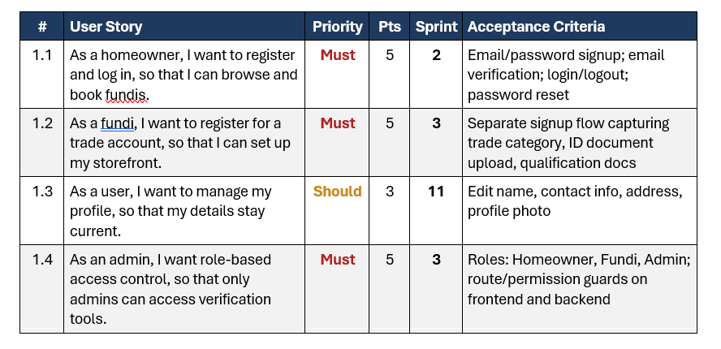

# Product Backlog

*The prioritised list of features, improvements and technical requirements needed to develop the FundiShop service marketplace.*

[Home & CV](README.md) | [Agile Project Portfolio (FundiShop)](portfolio.md) | [Agile Team Charter](charter.md) | [User Stories and Tasks](user-stories.md) | **Product Backlog** | [Sprint Backlog](sprint-backlog.md) | [Agile Logbook](logbook.md)

---

## 1. Project Overview

FundiShop is a web-based service marketplace designed to connect homeowners with local service providers, known as Fundis. The application aims to make it easier for homeowners to discover professionals, view their service information, request bookings and monitor the progress of their service requests. Fundis can use the platform to manage their professional profiles and respond to incoming booking requests.

The product backlog is an important part of the Agile development process because it provides an organised list of the features, improvements and technical requirements needed to develop the application. Each backlog item represents a specific piece of work that contributes to the overall product.

The backlog helps the team identify what needs to be developed, determine which items are most important and organise work according to user value, technical dependencies, risk and available development time. It can also be updated as the team gains experience, identifies problems and learns more about the application requirements.

## 2. Purpose of the Product Backlog

The main purpose of the FundiShop product backlog was to organise the development requirements and provide the team with a shared understanding of the work needed to build the marketplace.

It supported the project in the following ways:

- Identifying the main features required by homeowners and Fundis.
- Organising requirements according to their importance.
- Helping the team plan development activities.
- Identifying technical dependencies between features.
- Supporting the creation of user stories and development tasks.
- Providing a reference for selecting work during sprint planning.
- Allowing new requirements and improvements to be added as the project progressed.

The product backlog also helped connect the team's project objectives to the practical development work required to build a functional application.

## 3. Evidence

The evidence for this section should demonstrate how the FundiShop product backlog was organised and prioritised using the team's Trello board.

Trello was used to organise project activities and provide visibility into the work that needed to be completed. Backlog cards represented features, requirements and development activities that could be discussed, assigned and monitored.

**Supporting document:** [View the FundiShop Product Backlog PDF](backlog.pdf)

*Figure 1: FundiShop product backlog showing the planned product requirements and their prioritisation.*

The screenshot should show the actual backlog cards, their descriptions, priority information and any assigned team members. It should provide evidence that the backlog was used as part of the team's Agile planning process.

## 4. Prioritised Product Backlog

The following table presents the proposed product backlog for FundiShop. It includes the main features and technical activities identified during the development process.

The priority levels indicate the suggested order of importance based on the core purpose of the application. They should be compared with the actual priorities recorded on the team's Trello board.

| Priority | Backlog ID | Backlog item | Description | User value |
|---|---|---|---|---|
| High | PB01 | User Registration | Allow new homeowners and Fundis to create accounts. | Enables users to access personalised platform functionality. |
| High | PB02 | User Login | Allow registered users to access their accounts. | Provides access to the platform and role-specific features. |
| High | PB03 | Role-Based Access | Distinguish between homeowners, Fundis and administrators. | Ensures users access the appropriate application features. |
| High | PB04 | Find a Fundi | Allow homeowners to view available Fundis and their trade categories. | Helps homeowners discover suitable service providers. |
| High | PB05 | Fundi Profiles | Display professional information such as trade, biography, rates and service area. | Helps homeowners evaluate service providers. |
| High | PB06 | Create a Booking | Allow homeowners to submit booking requests with dates, times and job descriptions. | Supports the main service-request process. |
| High | PB07 | Booking Management | Allow Fundis to view and manage incoming booking requests. | Helps Fundis respond to homeowner requests. |
| High | PB08 | Homeowner Dashboard | Display a homeowner's bookings and their current statuses. | Allows homeowners to monitor their service requests. |
| Medium | PB09 | Fundi Dashboard | Provide Fundis with an overview of profiles and booking requests. | Organises important information in one place. |
| Medium | PB10 | Booking Status Updates | Support booking status changes such as accepting, declining and completing requests. | Improves visibility of booking progress. |
| Medium | PB11 | Validation and Error Handling | Validate user input and display appropriate error messages. | Improves reliability and usability. |
| Medium | PB12 | Responsive User Interface | Ensure important pages remain usable across supported screen sizes. | Improves accessibility and user experience. |
| Medium | PB13 | Frontend and Backend Integration | Connect React frontend components to Spring Boot backend services. | Allows the different application components to work together. |
| Medium | PB14 | Database Integration | Store and retrieve application information using MySQL and JPA. | Supports persistent user, profile and booking information. |
| Medium | PB15 | Integration and Subsystem Testing | Test frontend, backend and database functionality together. | Helps identify problems before the system is released. |
| Medium | PB16 | Administrator Functions | Provide appropriate administrative access and functionality. | Supports platform administration. |
| Low / Future | PB17 | Reviews and Ratings | Allow homeowners to provide feedback about completed services. | Could help users evaluate service providers. |
| Low / Future | PB18 | Notifications | Notify users about relevant booking events. | Could improve awareness of booking updates. |

**Note:** This is a reconstructed and proposed backlog based on the FundiShop functionality discussed during development. It should not be treated as a verified copy of the team's Trello board. The final list and priorities should match the actual project records.

## 5. Explanation of Backlog Priorities

The backlog items were grouped into three priority levels to help organise development work.

### 5.1 High Priority

High-priority items represent the essential functionality needed for FundiShop to operate as a service marketplace.

These include registration, login, role-based access, Fundi discovery, professional profiles and booking functionality.

These features form the main user journey. A homeowner must be able to access the platform, find a suitable Fundi and request a service. A Fundi must also be able to access the platform and manage incoming requests.

Without these features, the application would not be able to deliver its main purpose.

### 5.2 Medium Priority

Medium-priority items improve the functionality, reliability and overall user experience of the application.

Examples include dashboards, booking status updates, validation, responsive layouts, database integration and subsystem testing.

Although these features are not all the first steps in creating the marketplace, they are important for making the application more useful and dependable.

For example, the homeowner dashboard provides a central location for viewing booking information, while integration testing helps ensure that the frontend, backend and database communicate correctly.

### 5.3 Low or Future Priority

Low-priority items represent additional functionality that could be considered after the essential marketplace features are working reliably.

Examples include reviews, ratings and notifications.

These features could improve the platform in future versions, but the initial development effort should focus on completing and testing the main booking process.

## 6. Important Backlog Items and Acceptance Criteria

Acceptance criteria describe the conditions that should be satisfied before a backlog item can be considered complete.

### 6.1 User Registration

**Expected outcome:** Users should be able to create accounts using the required registration information.

Acceptance criteria:

- The registration form displays the required input fields.
- Required information is validated.
- Valid information is submitted to the backend.
- User information is saved in the database.
- Appropriate feedback is displayed when registration succeeds or fails.

### 6.2 User Login

**Expected outcome:** Registered users should be able to access their accounts.

Acceptance criteria:

- Users can enter their email and password.
- The submitted credentials are checked.
- Invalid credentials are handled appropriately.
- Successful login provides access to the appropriate user experience.

### 6.3 Find a Fundi

**Expected outcome:** Homeowners should be able to discover available service providers.

Acceptance criteria:

- Available Fundi profiles can be retrieved.
- Trade categories are displayed.
- Relevant professional information is visible.
- The page handles unavailable or empty results.

### 6.4 Booking Functionality

**Expected outcome:** Homeowners should be able to request services from selected Fundis.

Acceptance criteria:

- The homeowner can select a Fundi.
- The booking form captures the required date, time and job description.
- Valid booking details are submitted to the backend.
- The booking is associated with the correct homeowner and Fundi.
- A new booking is assigned its initial status.

### 6.5 Homeowner Dashboard

**Expected outcome:** Homeowners should be able to view their booking information.

Acceptance criteria:

- The dashboard retrieves bookings associated with the logged-in homeowner.
- Booking details are displayed.
- Booking statuses are visible.
- Booking summary information reflects the available records.
- Empty and error states are handled appropriately.

### 6.6 Fundi Dashboard

**Expected outcome:** Fundis should be able to view and manage their booking requests.

Acceptance criteria:

- The dashboard retrieves bookings associated with the Fundi.
- Relevant booking details are displayed.
- Supported booking status updates are handled.
- The dashboard handles situations where no requests are available.

## 7. Technical Requirements and Dependencies

The development of FundiShop required several technical components to work together.

The application used a separate React frontend and Spring Boot backend, with MySQL supporting persistent data storage.

The following technical requirements were important:

| Component | Technology | Purpose |
|---|---|---|
| Frontend | React and Vite | Provides the user interface and application pages. |
| Backend | Java and Spring Boot | Handles application logic and API requests. |
| Database | MySQL | Stores user, Fundi profile and booking information. |
| Data access | Spring Data JPA / Hibernate | Supports communication between backend entities and the database. |
| Development environment | IntelliJ IDEA | Used for backend development and project management. |
| Frontend development environment | Node.js and npm | Supports frontend dependencies and the Vite development server. |
| Project tracking | Trello | Supports task organisation and progress monitoring. |
| Team communication | Microsoft Teams | Supports discussions and coordination. |

Some backlog items depended on other items being available first.

For example:

- Booking functionality depended on user accounts and Fundi profiles.
- The homeowner dashboard depended on booking records being stored and retrieved correctly.
- The Fundi dashboard depended on the relationship between a Fundi profile and its booking requests.
- Frontend pages depended on backend API endpoints.
- Backend services depended on the database structure and entity relationships.

Understanding these dependencies helped the team recognise that features could not always be developed independently.

## 8. Backlog Refinement and Management

Product backlog refinement is the process of reviewing and improving backlog items so that they are clear, manageable and ready for development.

For FundiShop, backlog refinement involved considering whether requirements were understandable, whether tasks were too large and whether technical dependencies had been identified.

The following practices were important:

**Reviewing requirements:** Each backlog item needed to describe the functionality expected from the application.

**Breaking down large items:** Large features such as booking management could be divided into smaller tasks covering interface development, backend processing, database operations and testing.

**Reviewing priorities:** Items could be moved up or down depending on their importance, dependencies and development progress.

**Identifying dependencies:** The team needed to understand which features depended on other parts of the system.

**Monitoring progress:** Trello provided a visual way to follow tasks and identify work that remained incomplete.

**Updating the backlog:** New requirements and improvements could be added as the project developed.

This process helped keep the backlog relevant and supported more organised sprint planning.

## 9. Reflection

The product backlog played an important role in organising the work required to develop FundiShop. It provided a structured list of features, improvements and technical requirements and helped connect the project's overall objectives to the activities that needed to be completed.

When considering the backlog priorities, the main focus was the functionality required to make FundiShop operate as a service marketplace. Registration and login were important because users needed accounts to access the platform. Fundi discovery and professional profiles were important because homeowners needed to find suitable service providers. Booking functionality was particularly important because it represented the main interaction between homeowners and Fundis.

I learned that prioritisation should not be based only on which features are easiest or most interesting to develop. The team must consider the value of each feature to users, its technical dependencies, the risks involved and the amount of work required. For example, adding reviews and notifications could improve the platform in the future, but a dependable booking process was more important for the initial marketplace functionality.

One important technical lesson came from the integration of the frontend and backend. The application used React and Vite for the frontend, Spring Boot for the backend and MySQL for data storage. These components needed to communicate correctly. During development, the registration functionality encountered a CORS problem when the frontend attempted to communicate with the backend. This demonstrated that integration requirements should be considered during planning rather than waiting until the end of development.

Another important consideration was the relationship between booking functionality and the database. A booking needed to be associated with the correct homeowner and Fundi profile. This meant that database relationships and backend operations had to support the requirements described in the backlog. I learned that technical dependencies can influence the order in which features should be developed.

The product backlog also helped me understand the importance of breaking large features into smaller tasks. A feature such as the homeowner dashboard involved retrieving booking records, displaying statuses, calculating summary information and handling empty or unsuccessful responses. Dividing this feature into smaller activities made the work easier to understand and test.

If I were improving the backlog management process, I would make sure that every item included a clear description, priority, acceptance criteria, estimated effort and assigned team member. I would also encourage regular backlog refinement meetings so that the team could review progress, identify dependencies and update priorities. This would reduce confusion and make sprint planning more effective.

Overall, developing and organising the FundiShop product backlog improved my understanding of Agile planning, prioritisation and requirements management. I learned that a product backlog is not simply a list of features; it is a working planning document that helps a team make decisions about what should be developed, why it matters and how the work contributes to the overall product.

## 10. Conclusion

The FundiShop product backlog provided an organised approach to identifying and prioritising the features required for the service marketplace. It helped the team understand the essential functionality, consider technical dependencies and organise development activities according to their importance.

Through this process, I gained a better understanding of how prioritisation and backlog refinement support Agile software development. I also learned that a useful backlog must remain flexible and should be updated as requirements, technical challenges and development priorities change.

The product backlog served as an important link between the user stories and the sprint planning process. It helped transform user requirements into prioritised development work and supported the team's overall objective of building a functional and user-friendly service marketplace.

---

[← User Stories and Tasks](user-stories.md) | [Sprint Backlog →](sprint-backlog.md)

*© 2026 Christian Hakizimana · 219117675 · CPUT Diploma in ICT · PRP370S/371S/372S*
