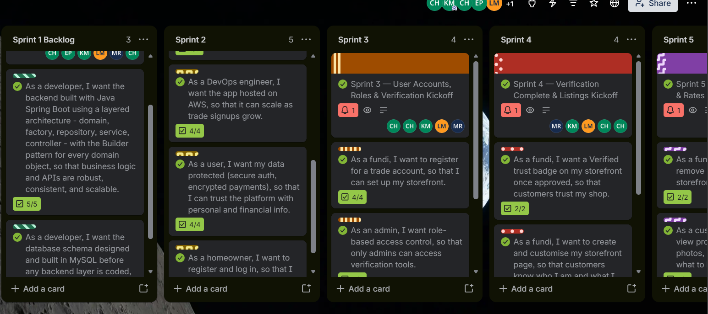

# Sprint Backlog

*The work selected for the sprint and the sprint goal.*

[Home & CV](README.md) | [Agile Project Portfolio (FundiShop)](portfolio.md) | [Agile Team Charter](charter.md) | [User Stories and Tasks](user-stories.md) | [Product Backlog](product-backlog.md) | **Sprint Backlog** | [Agile Logbook](logbook.md)

## Project Overview

FundiShop is a web-based marketplace that connects homeowners with local service providers, known as Fundis. The platform aims to make it easier for homeowners to find skilled professionals, request services and track their bookings. Fundis can create and manage their profiles, receive booking requests and respond to customers.

The sprint backlog translates selected product backlog items into smaller, manageable development tasks. It gives the team a clear understanding of what needs to be completed during a sprint, who is responsible for each task and how the work contributes to the overall project goal.

The sprint backlog also supports transparency and teamwork because members can monitor progress, identify challenges and adjust their work when necessary.

## Sprint Goal

The proposed sprint goal is to establish the main FundiShop user workflow by allowing users to register and log in, helping homeowners find Fundis, and supporting the creation and viewing of service bookings.

This goal focuses on developing the essential marketplace functionality. Completing these features would provide the foundation for additional functionality, such as booking status management, Fundi dashboards and further improvements to the user experience.

The goal and selected work items should be checked against the sprint that the team actually planned in Trello.

## Evidence

The screenshot below should show the actual FundiShop Trello sprint board. It should provide evidence of the work selected for the sprint, task assignments, progress columns and the team's organisation.

<a href="https://trello.com/b/aviqvFPS/fundishorp">Click here to view the FundiShop Trello Board</a>

*Figure 1: FundiShop Trello board showing the team's sprint planning and task progress, 2026. Replace the placeholder image with an actual screenshot from the board.*

## Selected Sprint Backlog Items

The following items are proposed examples for a sprint focused on the main FundiShop marketplace workflow. They are connected to the user stories and product backlog items described in the previous portfolio sections.

| ID | Selected item | Development tasks | Priority | Actual status |
|---|---|---|---|---|
| SB01 | User Registration | Create the registration form; validate required information; connect the form to the backend API; test successful and unsuccessful registration. | High | Update from Trello |
| SB02 | User Login | Create the login interface; connect login to backend authentication; display useful error messages; test login scenarios. | High | Update from Trello |
| SB03 | Find a Fundi | Build the Fundi listing page; display available Fundi profiles; retrieve profile information from the backend; test the listing page. | High | Update from Trello |
| SB04 | Create a Booking | Create the booking form; capture service date, time and job description; submit booking information to the backend; test booking validation and creation. | High | Update from Trello |
| SB05 | View Bookings | Retrieve bookings for the logged-in homeowner; display booking details and status; handle loading and empty states; test booking retrieval. | High | Update from Trello |
| SB06 | Integration and Testing | Check frontend-to-backend API requests; test database operations; identify and fix integration errors; verify the main user workflow. | High | Update from Trello |

*Note: These are proposed sprint backlog items, not a verified export of the team's Trello cards. Replace the items, priorities and statuses with the actual sprint selections where they differ.*

## Task Allocation

The team members have different responsibilities that support the development and coordination of FundiShop. The table below reflects the agreed team roles and suggests how each role could contribute to the proposed sprint.

| Team member | Agreed role | Possible sprint contribution |
|---|---|---|
| Kabelo Moloko | Scrum Master and Project Coordinator | Coordinate sprint activities, monitor blockers and support communication between team members. |
| Lisakhanya Mpahla | Product Owner | Clarify requirements, prioritise features and confirm acceptance criteria. |
| Christian Hakizimana | Backend and Database Developer | Contribute to backend endpoints, database integration, booking operations and testing of backend functionality. |
| Muhammad Siddeeq Rabin | Frontend Developer and Quality Assurance | Contribute to frontend interfaces, API integration and testing of user-facing functionality. |

*The suggested contributions are based on team responsibilities. Use the actual Trello assignments to confirm individual task ownership.*

## Sprint Task Breakdown

Breaking the selected backlog items into smaller tasks makes the work easier to understand and monitor.

### 1. User Registration and Login

- Design registration and login interfaces.
- Capture the information required from users.
- Connect the frontend forms to the backend.
- Validate user input and handle errors.
- Test the registration and login processes.

### 2. Fundi Discovery

- Develop the Fundi listing interface.
- Retrieve Fundi information from the backend.
- Display relevant profile information.
- Check that the page displays information correctly.
- Test the functionality from a homeowner's perspective.

### 3. Booking Management

- Develop the booking form.
- Connect booking submissions to the backend.
- Save booking information in the database.
- Retrieve bookings for the relevant homeowner.
- Display booking information and current status.
- Test the booking process.

### 4. Integration and Testing

- Verify communication between the frontend and backend.
- Check that API endpoints return the expected information.
- Test database operations.
- Identify and resolve integration problems.
- Test the main user journey from registration to booking.

## Definition of Done

A sprint backlog item should only be marked as complete when it satisfies the team's agreed completion criteria.

The suggested Definition of Done includes:

- The functionality meets the relevant user story's acceptance criteria.
- Required input validation and error handling are included.
- The frontend and backend work together where required.
- Data is stored and retrieved correctly where database functionality is involved.
- Relevant tests have been performed and identified issues addressed.
- The implementation has been reviewed according to the team's process.
- The Trello card reflects the actual task status.

Having a Definition of Done helps the team maintain a consistent standard of quality and prevents unfinished functionality from being treated as completed work.

## Sprint Progress and Review

During the sprint, the team should monitor the progress of each selected item and communicate any challenges that may affect delivery. Trello provides a shared view of the tasks, allowing members to see what has been completed, what is still in progress and what requires attention.

At the end of the sprint, the team should review its progress against the sprint goal and identify work that needs to continue in the next sprint.

| Review question | Information to record |
|---|---|
| What was completed? | List the items moved to Done and verified by the team. |
| What was unfinished? | Identify items still in progress or not started at the end of the sprint. |
| What blocked progress? | Describe actual technical issues, dependencies or team availability problems. |
| What went well? | Record successful collaboration, completed tasks or effective communication. |
| What should improve? | Identify specific planning, communication or testing improvements for the next sprint. |

*Complete this review using actual Trello card history, team discussions and sprint review information.*

## Challenges and Improvements

Some challenges that can affect a development sprint include unclear requirements, communication difficulties, technical problems and delays when integrating different parts of the application.

For FundiShop, frontend and backend integration is particularly important because the application depends on information being exchanged correctly between the user interface, API endpoints and database.

The team should address these challenges by:

- Discussing requirements before development begins.
- Assigning responsibilities clearly.
- Updating Trello when task progress changes.
- Reporting technical blockers as early as possible.
- Testing individual components before integrating them.
- Allowing enough time for integration and final testing.

These improvements can help the team reduce misunderstandings and make sprint delivery more predictable.

## Personal Contribution

My role in the FundiShop project is Backend and Database Developer. My contributions have included working on backend development, improving the database design and ERD, supporting the development of application functionality and participating in subsystem testing.

I also contributed to improving the user interface, particularly the Report Page, to make the application easier to use. These activities helped me understand how the frontend, backend and database components depend on one another.

Working on these areas gave me practical experience in connecting application requirements to technical implementation. It also helped me recognise the importance of testing individual components and checking that they work correctly as part of the complete system.

*Before submission, connect these contributions to the specific sprint in which they took place. Include the relevant Trello card, screenshot or development evidence where available.*

## Reflection

Sprint planning helps translate the product backlog into a manageable set of tasks that supports a specific development goal. In FundiShop, the proposed sprint focuses on essential marketplace functionality, including user registration, login, Fundi discovery and booking management. These features are connected because homeowners need to access the platform, find a suitable professional, request a service and view their bookings.

The sprint backlog also demonstrates the importance of breaking larger user stories into smaller development tasks. This makes responsibilities clearer and allows the team to monitor progress throughout the sprint. By connecting each task to a user story and product backlog item, the team can understand why the work is necessary and how it contributes to the overall project.

My experience working on FundiShop has shown me that development tasks often depend on one another. Backend functionality, database operations and frontend interfaces must work together to deliver a complete feature. A task may appear complete individually, but further integration and testing may still be required before it is ready for use.

Team communication is another important part of sprint execution. When requirements are unclear or members experience technical difficulties, tasks can take longer than expected. Keeping the Trello board updated and communicating blockers early can help the team respond before delays affect the sprint goal.

For future sprints, I would aim to improve task estimation, clarify acceptance criteria before development starts and allocate sufficient time for integration and testing. I would also encourage the team to review progress regularly and ensure that completed tasks meet the agreed Definition of Done. These practices can improve teamwork, accountability and the quality of the final FundiShop application.

## Links to Other Portfolio Sections

The Sprint Backlog builds on the work documented in the previous portfolio sections:

- **Agile Team Charter:** Establishes the team's purpose, responsibilities and working agreements.
- **User Stories and Tasks:** Describes the requirements from the perspective of homeowners and Fundis and breaks them into development tasks.
- **Product Backlog:** Provides the prioritised list of features and improvements from which sprint work is selected.
- **Sprint Backlog:** Identifies the selected work, tasks, responsibilities and sprint goal.
- **Agile Logbook:** Records the team's activities, progress, challenges and learning throughout the project.

Together, these sections demonstrate how the team organised, planned, developed and reviewed the FundiShop project using Agile practices.

## Conclusion

The sprint backlog provides a practical plan for turning FundiShop's product requirements into achievable development work. It connects the sprint goal to selected product backlog items, individual tasks and team responsibilities. By reviewing progress, communicating challenges and testing completed functionality, the team can work towards delivering a reliable marketplace that meets the needs of homeowners and Fundis.

---

[← Product Backlog](product-backlog.md) | [Agile Logbook →](logbook.md)

*© 2026 Christian Hakizimana · 219117675 · CPUT Diploma in ICT · PRP370S/371S/372S*
