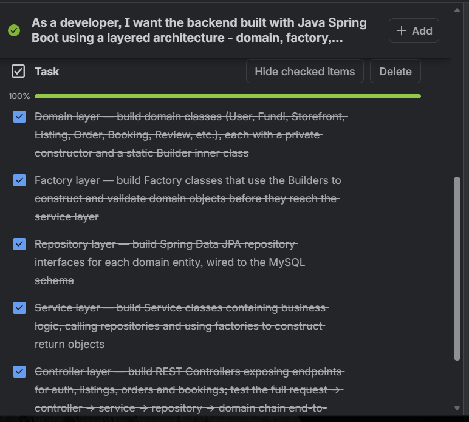

# User Stories and Tasks

*Features written from the end user's perspective and broken down into manageable development and testing tasks.*

[Home & CV](README.md) | [Agile Project Portfolio (FundiShop)](portfolio.md) | [Agile Team Charter](charter.md) | **User Stories and Tasks** | [Product Backlog](product-backlog.md) | [Sprint Backlog](sprint-backlog.md) | [Agile Logbook](logbook.md)

---

## 1. Project Overview

>FundiShop is a web-based service marketplace designed to connect homeowners with local service providers, known as Fundis. The platform aims to make it easier for homeowners to find professionals, view their service information, request services, arrange bookings and track the progress of their requests. Fundis can use the platform to maintain their professional profiles and manage incoming booking requests.

>The development of FundiShop required the team to understand the needs of its intended users before deciding which features to implement. User stories were used to describe these needs from the perspectives of homeowners and Fundis. Each story identifies the user, the functionality required and the reason that functionality is important.

>These stories were then divided into smaller development and testing tasks. This made it easier to organise the work, allocate responsibilities and monitor progress using the team's Agile workflow and Trello board.

## 2. Understanding the Users

The main users considered during the development of FundiShop were homeowners and Fundis.

### 2.1 Homeowners

Homeowners are users who need assistance with household services. They require a platform where they can find suitable professionals, view service information, request bookings and monitor their requests.

Their main needs include:

>- Creating a personal account.
>- Logging into the platform securely.
>- Finding Fundis based on their services and trade categories.
>- Viewing professional profiles and service information.
>- Submitting booking requests.
>- Viewing previous and current bookings.
>- Tracking booking statuses.

### 2.2 Fundis

Fundis are service professionals who use the platform to connect with homeowners and manage service requests.

Their main needs include:

>- Registering and accessing their accounts.
>- Maintaining professional profile information.
>- Displaying their trade category and service details.
>- Viewing incoming booking requests.
>- Responding to booking requests.
>- Managing the status of their bookings.

Understanding these user needs helped the team identify the essential functionality required for the first version of FundiShop.

## 3. Evidence

The evidence for this section should demonstrate how the team identified user requirements and converted them into development tasks.

The FundiShop Trello board was used to organise project activities and monitor tasks. User stories and their related tasks provided a way to break larger requirements into smaller pieces of work that could be assigned, discussed and tracked.

**Supporting document:** [View the FundiShop Product Backlog With UserStory and subtasks PDF](backlog.pdf)

*Figure 1: FundiShop user stories and related development tasks, intended to be evidenced through the team's Trello board.*

The screenshot should show the actual Trello cards, task descriptions, assigned members and progress information. The PDF provides additional project planning information.

## 4. User Stories and Development Tasks

The following user stories describe the main functionality of FundiShop. Each story is written from the perspective of the intended user and is divided into tasks covering interface development, backend functionality, database operations and testing.

### 4.1 User Story 1: User Registration

**As a** new user, **I want** to register for a FundiShop account, **so that** I can access the platform using my own account.

**Purpose:**

Registration allows homeowners and Fundis to create accounts and access the functionality associated with their user roles.

**Development tasks:**

- Design and develop the registration page.
- Create the required form fields for user information.
- Validate information entered into the registration form.
- Connect the registration page to the Spring Boot backend.
- Create the functionality for saving user information.
- Store valid user details in the MySQL database.
- Display appropriate success and error messages.
- Test registration using valid and invalid information.

**Acceptance criteria:**

- A new user can enter the required registration information.
- Required fields are validated before submission.
- Valid registration information is submitted to the backend.
- User details are saved in the database when registration succeeds.
- Appropriate feedback is displayed when registration fails.

### 4.2 User Story 2: User Login

**As a** registered user, **I want** to log in to FundiShop, **so that** I can access the features available to my account.

**Purpose:**

The login functionality provides users with access to the application and allows the system to identify their roles.

**Development tasks:**

- Design and develop the login interface.
- Add email and password input fields.
- Validate the login form.
- Connect the frontend login functionality to the backend.
- Check the submitted login details.
- Handle unsuccessful login attempts.
- Display appropriate error messages.
- Test login using valid and invalid credentials.

**Acceptance criteria:**

- Registered users can enter their login details.
- The system checks the submitted credentials.
- Invalid login information is handled appropriately.
- Successful login provides the appropriate user experience.
- The user's role is considered when accessing role-specific functionality.

### 4.3 User Story 3: Find a Fundi

**As a** homeowner, **I want** to find local Fundis based on their services, **so that** I can identify a suitable professional for my household needs.

**Purpose:**

This feature helps homeowners discover service providers and understand what services they offer before making a booking request.

**Development tasks:**

- Create the Find a Fundi page.
- Display available Fundi profiles.
- Display trade categories such as electrical, plumbing, carpentry, painting and general handyman services.
- Retrieve Fundi information from the backend.
- Display relevant professional information.
- Improve the layout and usability of the service listings.
- Test the page using available and empty result sets.

**Acceptance criteria:**

- Homeowners can access the Find a Fundi section.
- Available Fundi profiles are displayed.
- Relevant trade and professional information is visible.
- The page handles situations where no profiles are available.
- The information displayed is retrieved from the appropriate application data.

### 4.4 User Story 4: View a Fundi Profile

**As a** homeowner, **I want** to view a Fundi's professional profile, **so that** I can learn more about the service provider before requesting a booking.

**Purpose:**

A professional profile provides useful information about a Fundi and helps homeowners understand the services available.

**Development tasks:**

- Develop the Fundi profile interface.
- Retrieve the relevant Fundi profile information.
- Display the Fundi's trade category.
- Display the professional biography and service information.
- Display available pricing information where provided.
- Connect the profile page to the backend API.
- Test profile retrieval and display.

**Acceptance criteria:**

- A homeowner can open a Fundi profile.
- The correct profile information is displayed.
- Relevant service and pricing information is shown when available.
- The page handles missing or unavailable profile information appropriately.

### 4.5 User Story 5: Create a Booking

**As a** homeowner, **I want** to request a booking with a Fundi, **so that** I can arrange assistance for a service I need.

**Purpose:**

The booking functionality allows homeowners to submit service requests to selected Fundis.

**Development tasks:**

- Design the booking form.
- Capture the selected Fundi.
- Capture the requested booking date and time.
- Capture the job description.
- Validate the submitted booking information.
- Connect the booking form to the backend booking API.
- Create the booking record in the database.
- Assign the initial booking status.
- Display suitable confirmation or error messages.
- Test booking submission and validation.

**Acceptance criteria:**

- A homeowner can submit a booking request.
- The required booking information is captured.
- The booking is associated with the correct homeowner and Fundi.
- A successfully created booking receives its initial status.
- Invalid booking information is handled appropriately.

### 4.6 User Story 6: Track Bookings

**As a** homeowner, **I want** to view my bookings and their statuses, **so that** I can monitor the progress of my service requests.

**Purpose:**

The homeowner dashboard provides an overview of booking activity and helps users understand the current state of their requests.

**Development tasks:**

- Develop the homeowner dashboard.
- Retrieve bookings associated with the logged-in homeowner.
- Connect the dashboard to the booking API.
- Display booking information.
- Display booking dates and job descriptions.
- Display booking statuses.
- Calculate booking summary information.
- Handle loading, empty and error states.
- Test that the correct homeowner's bookings are displayed.

**Acceptance criteria:**

- A homeowner can access their dashboard.
- Only bookings associated with the relevant homeowner are retrieved for display.
- Booking details and statuses are visible.
- Booking summaries reflect the available booking records.
- The dashboard handles users who have no bookings.

The booking statuses used in the application include:

| Status | Meaning |
|---|---|
| REQUESTED | The homeowner has submitted a booking request. |
| ACCEPTED | The Fundi has accepted the request. |
| DECLINED | The Fundi has declined the request. |
| RESCHEDULED | The booking has been rescheduled. |
| COMPLETED | The service has been completed. |
| CANCELLED | The booking has been cancelled. |

### 4.7 User Story 7: Manage Booking Requests

**As a** Fundi, **I want** to view and manage incoming booking requests, **so that** I can respond to homeowners who need my services.

**Purpose:**

This functionality allows Fundis to manage requests submitted by homeowners and keep their booking information up to date.

**Development tasks:**

- Develop the Fundi dashboard.
- Retrieve bookings associated with the Fundi's profile.
- Display incoming booking requests.
- Display relevant homeowner and job information.
- Display current booking statuses.
- Implement the permitted booking status updates.
- Connect the dashboard to the backend booking services.
- Test booking retrieval and status changes.

**Acceptance criteria:**

- A Fundi can access the relevant dashboard.
- Booking requests associated with the Fundi are displayed.
- Relevant booking information is visible.
- Supported status updates are reflected in the application.
- The dashboard handles situations where no requests are available.

### 4.8 User Story 8: Manage a Fundi Profile

**As a** Fundi, **I want** to maintain my professional profile, **so that** homeowners can learn about my services and professional information.

**Purpose:**

The Fundi profile supports the presentation of professional information on the marketplace.

**Development tasks:**

- Develop the Fundi profile interface.
- Retrieve Fundi profile information.
- Display the trade category.
- Display the biography and service details.
- Display callout fees and hourly rates where available.
- Display the service area information.
- Connect profile information to the backend.
- Test profile retrieval and display.

**Acceptance criteria:**

- Fundi profile information can be retrieved.
- The correct professional information is displayed.
- Relevant service details are available to homeowners.
- Missing profile information is handled appropriately.

## 5. Task Allocation and Team Responsibilities

The team's responsibilities were divided according to the roles established in the Agile Team Charter.

| Team member | Agreed role | Main area of responsibility |
|---|---|---|
| Kabelo Moloko | Scrum Master and Project Coordinator | Support sprint coordination, monitor progress, organise team activities and help resolve blockers. |
| Lisakhanya Mpahla | Product Owner | Clarify user needs, prioritise requirements and help confirm product priorities. |
| Christian Hakizimana | Backend and Database Developer | Contribute to backend APIs, database design, data handling and integration. |
| Muhammad Siddeeq Rabin | Frontend Developer and Quality Assurance | Contribute to user interfaces, frontend integration, usability and software testing. |

The division of responsibilities provided structure, but the team also needed to collaborate when tasks involved multiple parts of the system.

For example, implementing the booking functionality required a frontend form, backend processing, database relationships and testing. This meant that individual responsibilities had to support the overall development objective.

## 6. My Individual Contribution

My contribution to FundiShop focused on development activities, particularly backend and database-related work, system integration, interface improvements and testing.

Some of the areas I contributed to included:

**Backend development:** Working with the Spring Boot backend structure and application functionality, including the handling of user, Fundi profile and booking-related data.

**Database design:** Contributing to the database structure and entity relationships needed to support the main application features.

**Booking functionality:** Working with booking-related information, including the homeowner, Fundi profile, scheduled date, time, job description and booking status.

**Frontend improvements:** Contributing to improvements in the application's user interface, particularly the Report Page work discussed during the wider project development.

**Testing and troubleshooting:** Helping identify and investigate application problems, including issues involving frontend and backend communication.

These activities helped me understand how different development responsibilities contribute to the completion of a single software product.

## 7. Relationship Between User Stories and Development Tasks

User stories describe what users need from the system, while development tasks explain the work required to implement those needs.

For example, the homeowner booking story describes the need to request a service from a Fundi. This story can be divided into the following development activities:

1. Design the booking form.
2. Capture the required booking information.
3. Validate the submitted information.
4. Send the information to the backend.
5. Process the booking request.
6. Save the booking information in the database.
7. Display confirmation to the homeowner.
8. Test the booking process.

Breaking a user story into smaller tasks makes it easier to allocate responsibilities, estimate work and monitor progress.

It also helps the team identify dependencies. In the booking example, the frontend form depends on the backend endpoint, while the backend depends on the database structure and relationships.

This connection is important because a user story should not be considered complete simply because one part of the functionality has been developed.

## 8. Reflection

When developing the FundiShop user stories, the main end users considered were homeowners and Fundis. Homeowners needed a convenient way to find service providers, view professional information, request bookings and track the progress of their requests. Fundis needed a way to present their services, view incoming requests and manage booking responses. Identifying these needs helped the team focus on features that would provide value to the people using the application.

The user stories followed the format "As a..., I want..., so that..." to identify the user, the requested functionality and the reason for the feature. I learned that this format makes requirements easier to understand because it explains the purpose of a feature rather than only describing a technical activity. For example, instead of simply saying that a booking form must be developed, the story explains that a homeowner needs to request a service from a Fundi. This gives the development team a clearer understanding of why the functionality is necessary.

After identifying the stories, the next step was to divide them into smaller development and testing tasks. This was important because features such as registration, booking and dashboard management involved different parts of the application. A booking feature, for example, required a frontend form, backend processing, database relationships and testing. Dividing this work made it easier to understand what needed to be completed and how the different components depended on one another.

One important lesson I learned was that requirements need to be clear before development begins. If a user story is too broad or does not explain what the system should do, team members may interpret it differently. This can lead to confusion, repeated work or incomplete functionality. Acceptance criteria help reduce this problem by describing the expected behaviour of a feature and providing a basis for testing.

The development of FundiShop also helped me understand the relationship between user stories and technical implementation. For example, the requirement for homeowners to track bookings was connected to the development of the homeowner dashboard and the retrieval of booking records from the backend. The system needed to retrieve bookings associated with the correct homeowner and display their statuses. This showed me that user requirements must be translated into working functionality through coordinated frontend, backend and database development.

My individual contribution helped me gain practical experience in understanding application requirements and connecting them to software development activities. Working with backend functionality, database structures, booking information, interface improvements and testing showed me that software development requires attention to both user needs and technical implementation. I also learned that testing is important because a feature can appear correct on the interface while still having problems when communicating with the backend or database.

If I were improving this process, I would ensure that every user story on the Trello board included clear acceptance criteria, a priority, an assigned team member and smaller development tasks. I would also encourage the team to review stories before starting implementation to ensure that everyone understands the expected outcome. This would improve task allocation, reduce misunderstandings and make progress easier to measure.

Overall, creating user stories and breaking them into tasks improved my understanding of requirements analysis, Agile planning and collaborative software development. It helped me see how user needs become practical development activities and how those activities contribute to building a functional service marketplace.

## 9. Connection to the Other Portfolio Sections

The User Stories and Tasks section builds directly on the Agile Team Charter. While the charter established the team's purpose, responsibilities and working agreements, the user stories explain what the intended users need from FundiShop.

The **Product Backlog** takes these user requirements and organises the features, improvements and technical work into a prioritised list. This helps the team decide which requirements are most important.

The **Sprint Backlog** then selects work from the product backlog and turns it into a focused plan for a particular sprint. It helps the team understand what needs to be completed during that development period.

The **Agile Logbook** records the activities, progress, challenges and reflections that occur while completing the planned tasks. It provides evidence of how the team worked towards implementing the user stories.

Together, these sections show how the project moved from defining the team's direction to understanding user needs, prioritising requirements, planning development and recording progress.

## 10. Conclusion

The user stories and tasks provided a structured way of understanding the requirements of FundiShop from the perspectives of homeowners and Fundis. They helped identify the platform's essential features and divide them into manageable development activities. Through this process, I developed a better understanding of how requirements analysis supports software development and how user stories can guide implementation and testing.

I also learned that clear acceptance criteria, task allocation and communication are important for successful Agile development. The user stories provided the foundation for the product backlog and sprint planning process, while the related tasks helped guide the team's practical development activities. Overall, this section demonstrates how user needs were translated into planned work towards building the FundiShop service marketplace.

---

[← Agile Team Charter](charter.md) | [Product Backlog →](product-backlog.md)

*© 2026 Christian Hakizimana · 219117675 · CPUT Diploma in ICT · PRP370S/371S/372S*
